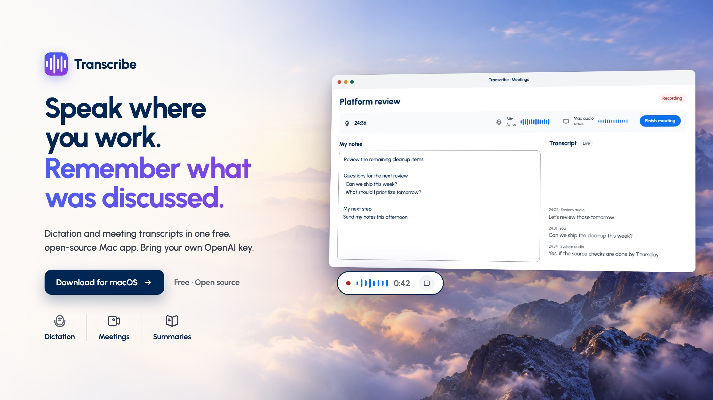

# Transcribe

**[Download Transcribe 2.1.0 for Mac](https://github.com/brainforwarding/transcribe/releases/download/v2.1.0/Transcribe.dmg)** · Apple Silicon, macOS 13 or later · signed and notarized

Open the download, drag Transcribe to Applications, then open it.

**Install with Bash**

```bash
curl -fsSL --proto '=https' https://raw.githubusercontent.com/brainforwarding/transcribe/master/scripts/install-mac.sh | /bin/bash
```

**Ask your agent to install it**

```text
Install Transcribe for Mac using the signed release and instructions at https://github.com/brainforwarding/transcribe/blob/master/docs/INSTALL.md
```

[Installation details](docs/INSTALL.md)



A Mac app that turns speech into text. Use it to dictate into any app, or to record a meeting and get a transcript and notes.

https://github.com/user-attachments/assets/d4a4af78-cfd9-4e01-9ce1-a4d9795d30bd

## Dictation

Dictation transcribes continuously while you speak. Double-tap Option and talk. Tap Option once to finish, and the text is pasted where your cursor is: an email, a chat, a document, a terminal.



A dictation can last up to five minutes. If a paste goes wrong, Option–Shift–V pastes the last one again, and every dictation stays in the history.

## Meetings

Record an online call (your microphone plus the audio playing on your Mac) or an in-person conversation (microphone only). The live transcript keeps each passage where it first appeared. When you finish, the meeting is a title, one paragraph saying what happened, and the transcript; **Copy transcript** pastes cleanly into Slack. Drop an audio or video file on the window, including a WhatsApp voice note: release it on the left to make a meeting, on the right to make a dictation.



## Get started

1. Open the disk image and drag Transcribe into Applications.
2. Open **Settings → Connection**, choose **OpenAI** and paste your [OpenAI API key](https://platform.openai.com/api-keys). OpenAI bills your account for what you use.
3. Allow the permissions macOS asks for:
   - **Microphone**, to record.
   - **Accessibility**, for the Option shortcut and for pasting.
   - **Screen & System Audio Recording**, only for online meetings. You may need to quit and reopen Transcribe after granting it.

Audio and text needed for transcription, formatting and meeting notes are sent to OpenAI. Your history is stored on your Mac. Tell people before you record them.

Versions 2.0.9 and later show available updates as a small **Actualizar** button that downloads, installs and restarts the app. If you have an older version, install the current Mac download once to enable in-app updates.

## More

- [App guide](TranscribeBar/README.md): every feature in detail, and how to build from source.
- [Command-line recorder](docs/cli.md): `meetrec.py`, the same meeting capture from the terminal.
