# Transcribe

A Mac app that turns speech into text. Use it to dictate into any app, or to record a meeting and get a transcript and notes.

**[Download Transcribe 2.0.10 for Mac](https://github.com/brainforwarding/transcribe/releases/download/v2.0.10/Transcribe.dmg)** · Apple Silicon, macOS 13 or later · signed and notarized

## Dictation

Double-tap Option and talk. Tap Option once to finish, and the text is pasted where your cursor is: an email, a chat, a document, a terminal.

A dictation can last up to five minutes. If a paste goes wrong, Option–Shift–V pastes the last one again, and every dictation stays in the history.

## Meetings

Record an online call (your microphone plus the audio playing on your Mac) or an in-person conversation (microphone only). Read the live transcript and write your own notes while it records. Confirmed passages stay unchanged. When you finish, get a separate summary of decisions and next steps with links back to supporting transcript passages.

## Get started

1. Open the disk image and drag Transcribe into Applications.
2. Open **Settings → Connection**, choose **OpenAI** and paste your [OpenAI API key](https://platform.openai.com/api-keys). OpenAI bills your account for what you use.
3. Allow the permissions macOS asks for:
   - **Microphone**, to record.
   - **Accessibility**, for the Option shortcut and for pasting.
   - **Screen & System Audio Recording**, only for online meetings. You may need to quit and reopen Transcribe after granting it.

Audio and text needed for transcription, formatting and meeting notes are sent to OpenAI. Your history is stored on your Mac. Tell people before you record them.

Install 2.0.9 manually once. Future versions appear as a small **Actualizar** button that downloads, installs and restarts the app.

## More

- [App guide](TranscribeBar/README.md): every feature in detail, and how to build from source.
- [Command-line recorder](docs/cli.md): `meetrec.py`, the same meeting capture from the terminal.
